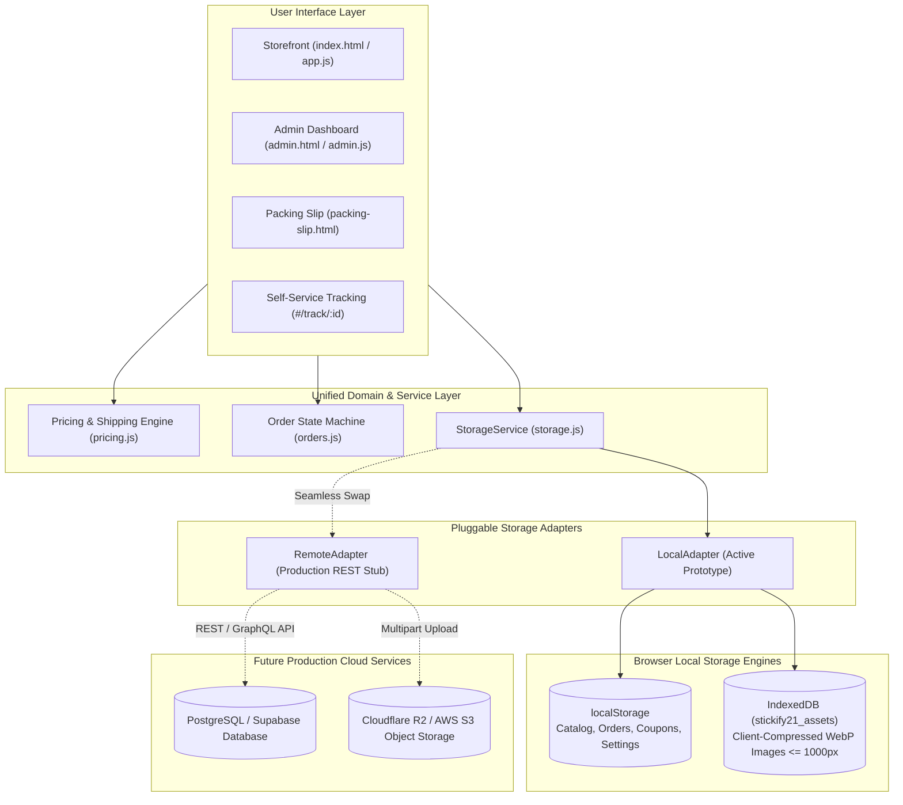

# STICKIFY 21 — STICK YOUR VIBE 🚀
### متجر استيكرات وفواصل كتب مصري عالي الجودة | High-Quality Egyptian Vinyl Stickers & Bookmarks

> **Language Notice:** This document is presented bilingually in **English** and **العربية (Egyptian Arabic)**.
> **ملاحظة:** هذا الدليل متوفر باللغتين الإنجليزية والعربية لتسهيل التطوير والنشر.

---

## 🌟 English Overview

**STICKIFY 21** is a specialized Egyptian e-commerce brand designed for university students, tech enthusiasts, and avid readers. It offers:
- **Die-cut waterproof vinyl stickers:** 3 official sizes (Small 6 cm, Medium 8 cm, Large 10 cm) with 2 finishes (Glossy, Matte).
- **Premium cardstock bookmarks:** 15 × 5 cm, 350gsm cardstock with double-sided matte lamination.
- **Custom print studio:** Custom batch orders for universities, tech clubs, book clubs, and corporate branding starting from 10 pieces with tiered volume pricing.
- **Identity & Colors:** Brand Orange `#FF5000` (hover `#E04600`), Deep Black `#0E0E10`, Clean White `#FAFAFA`, WhatsApp Green `#25D366`.
- **Typography:** `Readex Pro` (Arabic UI) and `Space Grotesk` (Numbers & Latin accents).

The project is built with **Vanilla JavaScript (ES Modules)** and precompiled **Tailwind CSS**, operating completely offline/locally without any paid cloud services or external database dependencies, while maintaining a **clean enterprise architectural boundary** ready for seamless backend migration.

---

## ⚡ 3-Command Quick Start (التشغيل السريع)

To run the project locally on your computer:

```bash
# 1. Install dev dependencies (Tailwind CLI & Playwright)
npm install

# 2. (Optional) Rebuild Tailwind CSS if modifying utility classes
npm run build:css

# 3. Start the local server
python scripts/server.py 3000
# or alternatively:
# npx serve .
```

Then open your browser at: **`http://localhost:3000`** (or `http://127.0.0.1:3000`).

> [!IMPORTANT]
> **Why is a local HTTP server required?**
> The application uses standard ECMAScript modules (`<script type="module">`). Browsers block module imports over the `file://` protocol due to strict Cross-Origin (CORS) security policies. Opening `index.html` by double-clicking will display an informative bilingual guidance screen instead of a broken page.

---

## 🏗 Architecture & Project Structure (الهيكلية البرمجية)

```
stickify21/
├── index.html                  # Main storefront entry point (RTL, Egyptian Arabic)
├── admin.html                  # Admin management dashboard (Orders, Products, Coupons, Settings)
├── packing-slip.html           # Print-optimized packing slip (Single & batch printing)
├── app.js                      # Storefront orchestration & event delegation
├── admin.js                    # Admin dashboard logic & data bindings
├── logo.jpg                    # Official brand logo
├── robots.txt                  # Search engine crawler directives
├── sitemap.xml                 # Canonical XML sitemap
├── tailwind.config.js          # Tailwind CLI configuration
│
├── dist/
│   └── styles.css              # Precompiled, committed Tailwind CSS (runs without Node.js)
│
├── src/
│   ├── config/
│   │   └── config.js           # Central configuration (shipping rates, contacts, thresholds)
│   ├── data/
│   │   ├── storage.js          # Unified async StorageService interface & RemoteAdapter stub
│   │   ├── localAdapter.js     # LocalStorage + IndexedDB (WebP compression <= 1000px)
│   │   ├── migrations.js       # Versioned database migration runner
│   │   └── seed.js             # Initial catalog seed data
│   ├── domain/
│   │   ├── pricing.js          # Unified pricing, pack bundles, and 27-gov shipping engine
│   │   ├── coupons.js          # Coupon validation, usage tracking, and discount calculator
│   │   ├── orders.js           # 6-state order lifecycle with transition validation & history
│   │   ├── products.js         # Product models and category relationships
│   │   ├── inventory.js        # Prototype stock tracking and availability guards
│   │   ├── auth.js             # Admin passcode security (PBKDF2 Web Crypto, lockout timer)
│   │   └── validation.js       # Strict Egyptian phone, address, and input validator
│   └── utils/
│       ├── escape.js           # XSS defense (escapeHtml, sanitizeSvg, sanitizeUrl)
│       ├── ids.js              # Cryptographic IDs (S21-YYMMDD-XXXX) & Base64url Order Codes
│       └── analytics.js        # Privacy-preserving analytics dispatcher (GA4 & Meta Pixel hooks)
│
├── docs/
│   ├── AUDIT.md                # Exhaustive phase 1 audit log & resolutions
│   ├── DECISIONS.md            # Comprehensive architectural decision records (AD-01 to AD-25)
│   ├── LIMITATIONS.md          # Local prototype boundaries and multi-device explanation
│   └── LAUNCH-CHECKLIST.md     # Production deployment checklist & server migration guide
│
├── tests/                      # 100% automated Playwright test suite (34 passing tests)
│   ├── phase1.spec.js          # Bug fixes, sizing, pack integrity, XSS sanitization
│   ├── phase2.spec.js          # Data layer, 6-state orders, PBKDF2 auth, Base64url Order Code
│   ├── phase3.spec.js          # Custom print studio, deep link modals, multi-payment options
│   ├── phase4.spec.js          # Admin KPIs, bulk actions, UTF-8 BOM CSV, 27-gov settings, batch slips
│   ├── phase5.spec.js          # SEO meta, crawler directives, dynamic JSON-LD, legal policy modals
│   └── phase6.spec.js          # Full end-to-end integration, WebP compression, corrupt data recovery
│
└── scripts/
    └── server.py               # Lightweight local Python HTTP server with UTF-8 support
```

---

## 🔄 Data Flow & Storage Architecture (تدفق البيانات ونظام التخزين)

All data access throughout the entire storefront and admin dashboard goes through a **single asynchronous interface** (`StorageService`). No UI component or domain module touches `localStorage` or `IndexedDB` directly.



---

## 📱 WhatsApp Order Code Bridge & Prototype Limitations (نظام كود الطلب)

In a pure frontend prototype running without a shared backend database, **data stored in the customer's browser cannot automatically appear in the store owner's browser on another device**.

### How STICKIFY 21 Solves This Gap:
1. When a customer checks out, the order is saved locally, and a structured WhatsApp message is generated for `+20 104 354 6503`.
2. Attached to the message is a compact, URL-safe **Order Code** (`S21CODE:<base64url_json>`).
3. In `admin.html`, the store owner clicks **"استيراد طلب من واتساب" (Import WhatsApp Order)** and pastes the customer's message.
4. The system decodes, validates, and imports the complete order directly into the admin dashboard with zero data loss.

> [!NOTE]
> Detailed technical boundaries, browser isolation rules, and multi-device operation are fully documented in [LIMITATIONS.md](file:///docs/LIMITATIONS.md).

---

## 🚀 Migration Guide to a Real Backend (دليل الانتقال لقاعدة بيانات حقيقية)

The application has been architected specifically for zero-rewrite backend migration:

1. **Keep the UI and Domain Unchanged:**
   `app.js`, `admin.js`, `pricing.js`, `validation.js`, and `orders.js` do not need any modifications.
2. **Implement `RemoteAdapter`:**
   In [src/data/storage.js](file:///src/data/storage.js), complete the ready-made `RemoteAdapter` class to connect to your backend REST API (e.g., Node.js / Express, Python / FastAPI, Supabase, or Laravel):
   ```javascript
   // src/data/storage.js
   // Replace:
   export const storage = new StorageService(new LocalAdapter());
   // With:
   export const storage = new StorageService(new RemoteAdapter('https://api.stickify21.com/v1'));
   ```
3. **Move Asset Uploads to Object Storage:**
   Route custom print artwork and product photos directly to an S3-compatible bucket (Cloudflare R2, AWS S3) instead of local `IndexedDB`.
4. **Follow the Launch Checklist:**
   Review [LAUNCH-CHECKLIST.md](file:///docs/LAUNCH-CHECKLIST.md) for complete instructions on server-side coupon validation, payment gateway webhooks (InstaPay, Vodafone Cash, Paymob), and security hardening.

---

## 🧪 Testing & Quality Assurance (الاختبارات الآلية)

The repository includes a comprehensive, automated end-to-end test suite powered by **Playwright** with **34 passing tests**:

```bash
# Run the entire test suite across all 6 phases:
npx playwright test

# Run a specific phase test:
npx playwright test tests/phase1.spec.js
npx playwright test tests/phase2.spec.js
npx playwright test tests/phase3.spec.js
npx playwright test tests/phase4.spec.js
npx playwright test tests/phase5.spec.js
npx playwright test tests/phase6.spec.js
```

### Verified Acceptance Test Breakdown:
- **Phase 1 (6 Tests):** Zero console errors, visual sticker sizing (6/8/10 cm), pack bundle integrity, pointer events mockup bounds, coupon configuration, and strict XSS sanitization.
- **Phase 2 (5 Tests):** Unified storage adapter, 6-state order lifecycle with transition validation, PBKDF2 Web Crypto admin auth with lockout, Base64url WhatsApp Order Code import, and IndexedDB image storage.
- **Phase 3 (6 Tests):** Custom Print Studio tiered volume pricing, deep linkable `#product-detail-modal`, deep linkable order tracking, multi-payment checkout (COD, InstaPay, Vodafone Cash), and neutral car window mockup layer.
- **Phase 4 (6 Tests):** Real-time admin KPI cards, orders filtering & bulk status updates, UTF-8 BOM CSV export for Excel, product catalog CRUD, 27-governorate shipping configuration, and batch packing slip printing.
- **Phase 5 (6 Tests):** Complete SEO meta tags, crawler directives (`robots.txt`, `sitemap.xml`, `noindex`), dynamic Schema.org JSON-LD catalog, interactive legal policy modals (`#/terms`, `#/privacy`), and privacy-preserving analytics dispatcher.
- **Phase 6 (5 Tests):** Client-side WebP image compression (max 1000px), complete end-to-end customer purchase journey, complete admin management flow, self-service tracking, and resilient error recovery from corrupted storage.

---

## 🇪🇬 دليل المشروع باللغة العربية (Egyptian Arabic Guide)

### نبذة عن المشروع
**STICKIFY 21** هو متجر إلكتروني مصري متخصص في بيع استيكرات فينيل عالية الجودة مقاومة للماء وفواصل كتب أنيقة، مع ستوديو مخصص لطباعة التصاميم والكميات للمجموعات والجامعات والشركات:
- **المقاسات الرسمية للاستيكرات:** 6 سم (صغير)، 8 سم (وسط)، 10 سم (كبير).
- **الخامات واللمسات:** لامع (Glossy)، ومطفي (Matte).
- **فواصل الكتب:** كوشيه 350 جرام، سلوفان مطفي فاخر وجهين، مقاس 15 × 5 سم.
- **الطباعة المخصصة:** بدءاً من 10 قطع بأسعار تنافسية متدرجة (10-49 قطعة: 20 ج.م، 50-99 قطعة: 15 ج.م، 100+ قطعة: 10 ج.م).

### الألوان والهوية البصرية
- البرتقالي الرئيسي: `#FF5000` (hover: `#E04600`)
- الأسود الفاحم: `#0E0E10`
- الخلفية الفاتحة: `#FAFAFA`
- أخضر الواتساب: `#25D366`
- الخطوط: `Readex Pro` للنصوص والواجهة العربية، و `Space Grotesk` للأرقام واللمسات اللاتينية.

### بيانات الدخول الافتراضية للوحة التحكم (Admin Dashboard)
- **الرابط:** افتح `admin.html` في المتصفح.
- **رمز المرور الافتراضي (Default Passcode):** `2121`
- **الأمان:** محمي بتشفير PBKDF2 المدمج بالمتصفح مع حد أقصى 5 محاولات خاطئة قبل الإغلاق المؤقت لمدة 15 دقيقة.

### كيفية استيراد الطلبات من واتساب (Order Code Bridge)
نظراً لأن المشروع نموذج محلي (Prototype) يعمل داخل المتصفح دون خادم سحابي مشترك:
1. عند إتمام العميل للطلب، يظهر له كود مرمز بالواتساب: `S21CODE:XXXXX`.
2. من لوحة التحكم (`admin.html`)، اضغط على زر **"استيراد طلب من واتساب"**.
3. الصق رسالة الواتساب أو الكود، وسيتم تسجيل الطلب وتفاصيله بالكامل فوراً داخل لوحة التحكم لطباعة بوليصة الشحن ومتابعة الحالة.

---

## 📄 Documentation Links (روابط الوثائق)

- [AUDIT.md](file:///docs/AUDIT.md) — تقرير الفحص الشامل والمشاكل التي تم حلها.
- [DECISIONS.md](file:///docs/DECISIONS.md) — سجل القرارات المعمارية والتقنية (AD-01 إلى AD-25).
- [LIMITATIONS.md](file:///docs/LIMITATIONS.md) — حدود النموذج الأولي وكيفية التعامل مع التخزين المحلي.
- [LAUNCH-CHECKLIST.md](file:///docs/LAUNCH-CHECKLIST.md) — قائمة متطلبات الإطلاق الرسمي والربط بقاعدة بيانات وخوادم حقيقية.
