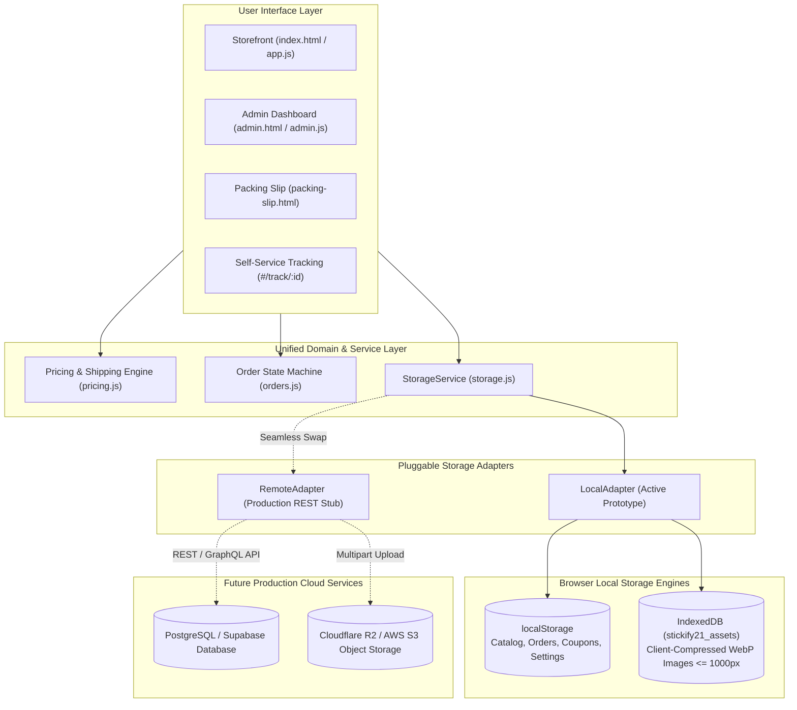

# STICKIFY 21 — STICK YOUR VIBE
### متجر استيكرات وفواصل كتب مصري عالي الجودة | High-Quality Egyptian Vinyl Stickers & Bookmarks

> **Language Notice:** Bilingual storefront (**العربية / English**, RTL/LTR mirroring) + Arabic owner Admin portal. Local-first prototype with **no backend** (`localStorage` + `IndexedDB`); all server-dependent workflows are transparently marked `DEMO` in `docs/LAUNCH-CHECKLIST.md`.

---

## English Overview

**STICKIFY 21** is a specialized Egyptian e-commerce prototype designed for university students, tech enthusiasts, and avid readers. It offers:
- **Die-cut waterproof vinyl stickers:** 3 official sizes (Small 6 cm, Medium 8 cm, Large 10 cm) with 2 finishes (**Glossy** and **Matte** — holographic fully purged & auto-migrated).
- **Premium cardstock bookmarks:** 15 × 5 cm, 350gsm cardstock with double-sided matte lamination.
- **Smart Packs & Auto-Grouping (R1, R10):** 5-sticker pack (-20%) and 10-sticker pack (-30%) with full pack contents visible across Cart, Checkout, WhatsApp message, `S21CODE` Order Code, Admin expandable rows, and Packing Slip PDFs.
- **True-to-Scale Interactive Mockup Studio (R5–R7):** Layered neutral SVG mockups (Laptop, Phone, Water Bottle with cylindrical squeeze, A5 Spiral Notebook, Novel Book with top bookmark slot), live `pxPerCm` metric ruler, and keyed GPU `transform` drag.
- **Safe Magic-Byte Uploads & Custom Print Studio (R14):** Strict PNG-only product art with alpha transparency detection & lossless PNG storage, plus multi-format custom print uploads (original bytes preserved in IndexedDB, SVG XSS sanitization, 300 DPI warning, WhatsApp Document workflow).
- **Admin Portal (`admin.html`, default PIN `2121`):** 8-state order lifecycle (`pending` -> `awaiting_confirmation` -> `confirmed` -> `preparing` -> `ready` -> `shipped` -> `completed`, plus `cancelled`), HMAC-SHA256 signed sessions backed by a non-extractable IndexedDB `CryptoKey`, 1-tap next-step buttons with 10s Undo, single-page A4/A5/Label PDF packing slips (`>= 8.5pt`), CSV export with formula-injection protection, Dark Mode, Showcase Manager, and 25/page pagination for 500+ orders.
- **Identity & Colors:** Brand Orange `#FF5000` (hover `#E04600`), Deep Black `#0E0E10`, Clean White `#FAFAFA`, WhatsApp Green `#25D366`.
- **Typography:** `Readex Pro` (Arabic UI) and `Space Grotesk` (Numbers & Latin accents).

---

## 3-Command Quick Start (التشغيل السريع)

To run the project locally on your computer:

```bash
# 1. Install dev dependencies (Tailwind CLI & Playwright)
npm install

# 2. Rebuild compiled Tailwind CSS
npm run build:css

# 3. Start the local server (or run tests via: npm test)
python scripts/server.py 3000
```

Then open:
- Storefront (Arabic): **`http://127.0.0.1:3000`**
- Storefront (English): **`http://127.0.0.1:3000/?lang=en`**
- Admin Portal (PIN `2121`): **`http://127.0.0.1:3000/admin.html`**

### Deploy to GitHub Pages (للمشاركة والتجربة أونلاين مجاناً 24/7)
1. Push this repository (including committed `dist/styles.css`) to a GitHub repository.
2. Go to **Repository Settings → Pages → Source: Deploy from a branch (`master` / `main`, folder `/ (root)`) → Save**.
3. Wait ~1 minute and share your permanent HTTPS URL: `https://<username>.github.io/<repo-name>/` (storefront) and `https://<username>.github.io/<repo-name>/admin.html` (admin).

> [!IMPORTANT]
> **Why is a local HTTP server (or GitHub Pages) required?**
> The application uses standard ECMAScript modules (`<script type="module">`). Browsers block module imports over `file://`. Opening `index.html` directly displays a clear bilingual guidance banner.

---

## Architecture & Project Structure (الهيكلية البرمجية)

```
stickify21/
├── index.html                  # Bilingual storefront (AR RTL / EN LTR, >=44px mobile targets)
├── admin.html                  # Arabic Admin portal (Dashboard, Orders, Products, Categories, Coupons, Showcase, Settings)
├── packing-slip.html           # Measure-and-compact single-page A4 / A5 / 100x150mm Label PDF generator
├── app.js                      # Storefront controller, keyed mockup studio, custom print & checkout
├── admin.js                    # Admin dashboard controller, paginated orders, CSV export & PNG upload
├── logo.jpg                    # Official brand logo
├── tailwind.config.js          # Tailwind CLI config (darkMode: 'class' + dynamic safelist)
├── dist/styles.css             # Precompiled, committed Tailwind CSS (auto-built before npm test)
│
├── src/
│   ├── config/config.js        # Central configuration (8 order states, 27 governorates, pricing tiers)
│   ├── i18n/                   # Complete 100% key-parity bilingual layer (ar.js, en.js, index.js)
│   ├── data/                   # StorageService (storage.js), LocalAdapter + IndexedDB, migrations.js, seed.js, policies.js
│   ├── domain/                 # pricing.js (O(n) auto-packs), orders.js (8-state machine + formatPayment), auth.js (PBKDF2 + IndexedDB HMAC CryptoKey), coupons.js, inventory.js, validation.js
│   └── utils/                  # fileValidation.js (magic bytes, alpha, lossless PNG, SVG XSS, 300 DPI), ids.js (8-char unambiguous crypto IDs + S21CODE), escape.js, emoji.js, arabic.js, icons.js, analytics.js
│
├── docs/                       # DECISIONS.md (AD-01..AD-53), LIMITATIONS.md, LAUNCH-CHECKLIST.md, COPY-REVIEW.md
├── audit/                      # Independent audit reports (REPORT-v3.md, REPORT-v4.md), logs & scripts
├── tests/                      # 83+ automated Playwright E2E, PDF, security, i18n, performance & mutation-guard tests
└── scripts/server.py           # Multithreaded local Python HTTP server
```

---

## Data Flow & Storage Architecture (تدفق البيانات ونظام التخزين)

All core catalog, order, showcase, custom-print, and binary asset operations flow through the unified asynchronous `StorageService` (`src/data/storage.js`) backed by `LocalAdapter` (`localStorage` + `IndexedDB`), with a documented `RemoteAdapter` REST stub ready for backend integration. Non-extractable HMAC session keys live in a dedicated IndexedDB store (`stickify21_auth_keys_db`).



---

## 📱 WhatsApp Order Code Bridge & Prototype Limitations (نظام كود الطلب)

In a pure frontend prototype running without a shared backend database, **data stored in the customer's browser cannot automatically appear in the store owner's browser on another device**.

### How STICKIFY 21 Solves This Gap:
1. When a customer checks out, the order is saved locally, and a structured WhatsApp message is generated for `+20 104 354 6503`.
2. Attached to the message is a compact, URL-safe **Order Code** (`S21CODE:<base64url_json>`).
3. In `admin.html`, the store owner clicks **"استيراد طلب من واتساب" (Import WhatsApp Order)** and pastes the customer's message.
4. The system decodes, validates, and imports the complete order directly into the admin dashboard with zero data loss.

> [!NOTE]
> Detailed technical boundaries, browser isolation rules, and multi-device operation are fully documented in [LIMITATIONS.md](file:///docs/LIMITATIONS.md).

---

## 🚀 Migration Guide to a Real Backend (دليل الانتقال لقاعدة بيانات حقيقية)

The application has been architected specifically for zero-rewrite backend migration:

1. **Keep the UI and Domain Unchanged:**
   `app.js`, `admin.js`, `pricing.js`, `validation.js`, and `orders.js` do not need any modifications.
2. **Implement `RemoteAdapter`:**
   In [src/data/storage.js](file:///src/data/storage.js), complete the ready-made `RemoteAdapter` class to connect to your backend REST API (e.g., Node.js / Express, Python / FastAPI, Supabase, or Laravel):
   ```javascript
   // src/data/storage.js
   // Replace:
   export const storage = new StorageService(new LocalAdapter());
   // With:
   export const storage = new StorageService(new RemoteAdapter('https://api.stickify21.com/v1'));
   ```
3. **Move Asset Uploads to Object Storage:**
   Route custom print artwork and product photos directly to an S3-compatible bucket (Cloudflare R2, AWS S3) instead of local `IndexedDB`.
4. **Follow the Launch Checklist:**
   Review [LAUNCH-CHECKLIST.md](file:///docs/LAUNCH-CHECKLIST.md) for complete instructions on server-side coupon validation, payment gateway webhooks (InstaPay, Vodafone Cash, Paymob), and security hardening.

---

## 🧪 Testing & Quality Assurance (الاختبارات الآلية)

The repository includes a comprehensive, automated end-to-end test suite powered by **Playwright** with **34 passing tests**:

```bash
# Run the entire test suite across all 6 phases:
npx playwright test

# Run a specific phase test:
npx playwright test tests/phase1.spec.js
npx playwright test tests/phase2.spec.js
npx playwright test tests/phase3.spec.js
npx playwright test tests/phase4.spec.js
npx playwright test tests/phase5.spec.js
npx playwright test tests/phase6.spec.js
```

### Verified Acceptance Test Breakdown:
- **Phase 1 (6 Tests):** Zero console errors, visual sticker sizing (6/8/10 cm), pack bundle integrity, pointer events mockup bounds, coupon configuration, and strict XSS sanitization.
- **Phase 2 (5 Tests):** Unified storage adapter, 6-state order lifecycle with transition validation, PBKDF2 Web Crypto admin auth with lockout, Base64url WhatsApp Order Code import, and IndexedDB image storage.
- **Phase 3 (6 Tests):** Custom Print Studio tiered volume pricing, deep linkable `#product-detail-modal`, deep linkable order tracking, multi-payment checkout (COD, InstaPay, Vodafone Cash), and neutral car window mockup layer.
- **Phase 4 (6 Tests):** Real-time admin KPI cards, orders filtering & bulk status updates, UTF-8 BOM CSV export for Excel, product catalog CRUD, 27-governorate shipping configuration, and batch packing slip printing.
- **Phase 5 (6 Tests):** Complete SEO meta tags, crawler directives (`robots.txt`, `sitemap.xml`, `noindex`), dynamic Schema.org JSON-LD catalog, interactive legal policy modals (`#/terms`, `#/privacy`), and privacy-preserving analytics dispatcher.
- **Phase 6 (5 Tests):** Client-side WebP image compression (max 1000px), complete end-to-end customer purchase journey, complete admin management flow, self-service tracking, and resilient error recovery from corrupted storage.

---

## 🇪🇬 دليل المشروع باللغة العربية (Egyptian Arabic Guide)

### نبذة عن المشروع
**STICKIFY 21** هو متجر إلكتروني مصري متخصص في بيع استيكرات فينيل عالية الجودة مقاومة للماء وفواصل كتب أنيقة، مع ستوديو مخصص لطباعة التصاميم والكميات للمجموعات والجامعات والشركات:
- **المقاسات الرسمية للاستيكرات:** 6 سم (صغير)، 8 سم (وسط)، 10 سم (كبير).
- **الخامات واللمسات:** لامع (Glossy)، ومطفي (Matte).
- **فواصل الكتب:** كوشيه 350 جرام، سلوفان مطفي فاخر وجهين، مقاس 15 × 5 سم.
- **الطباعة المخصصة:** بدءاً من 10 قطع بأسعار تنافسية متدرجة (10-49 قطعة: 20 ج.م، 50-99 قطعة: 15 ج.م، 100+ قطعة: 10 ج.م).

### الألوان والهوية البصرية
- البرتقالي الرئيسي: `#FF5000` (hover: `#E04600`)
- الأسود الفاحم: `#0E0E10`
- الخلفية الفاتحة: `#FAFAFA`
- أخضر الواتساب: `#25D366`
- الخطوط: `Readex Pro` للنصوص والواجهة العربية، و `Space Grotesk` للأرقام واللمسات اللاتينية.

### بيانات الدخول الافتراضية للوحة التحكم (Admin Dashboard)
- **الرابط:** افتح `admin.html` في المتصفح.
- **رمز المرور الافتراضي (Default Passcode):** `2121`
- **الأمان:** محمي بتشفير PBKDF2 المدمج بالمتصفح مع حد أقصى 5 محاولات خاطئة قبل الإغلاق المؤقت لمدة 15 دقيقة.

### كيفية استيراد الطلبات من واتساب (Order Code Bridge)
نظراً لأن المشروع نموذج محلي (Prototype) يعمل داخل المتصفح دون خادم سحابي مشترك:
1. عند إتمام العميل للطلب، يظهر له كود مرمز بالواتساب: `S21CODE:XXXXX`.
2. من لوحة التحكم (`admin.html`)، اضغط على زر **"استيراد طلب من واتساب"**.
3. الصق رسالة الواتساب أو الكود، وسيتم تسجيل الطلب وتفاصيله بالكامل فوراً داخل لوحة التحكم لطباعة بوليصة الشحن ومتابعة الحالة.

---

## 📄 Documentation Links (روابط الوثائق)

- [AUDIT.md](file:///docs/AUDIT.md) — تقرير الفحص الشامل والمشاكل التي تم حلها.
- [DECISIONS.md](file:///docs/DECISIONS.md) — سجل القرارات المعمارية والتقنية (AD-01 إلى AD-25).
- [LIMITATIONS.md](file:///docs/LIMITATIONS.md) — حدود النموذج الأولي وكيفية التعامل مع التخزين المحلي.
- [LAUNCH-CHECKLIST.md](file:///docs/LAUNCH-CHECKLIST.md) — قائمة متطلبات الإطلاق الرسمي والربط بقاعدة بيانات وخوادم حقيقية.
